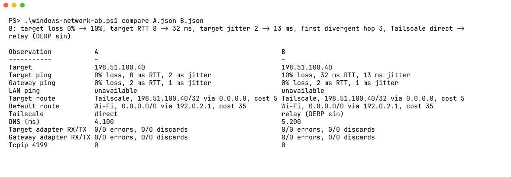

<!-- language-check: allow — Korean README -->
<div align="center">


# windows-network-ab

Windows에서 네트워크 상태를 두 번 수집해 어느 구간이 달라졌는지 알려 주는 PowerShell 스크립트입니다.

[English](README.md) · Windows PowerShell 5.1 · PowerShell 7

[](LICENSE)

[설치](#설치) · [빠른 시작](#빠른-시작) · [옵션](#옵션)

</div>

<p align="center">
  <picture>
    <source media="(prefers-color-scheme: dark)" srcset="https://raw.githubusercontent.com/elfenomenokim/windows-network-ab/main/docs/demo/compare-dark.png">
    
  </picture>
</p>

## 설치

[windows-network-ab.ps1](windows-network-ab.ps1)을 로컬 폴더에 받습니다.
NetTCPIP, NetAdapter와 이벤트 로그 명령을 쓸 수 있는 Windows에서
일반 사용자 권한으로 실행합니다. Tailscale 연결 방식도 확인하려면
해당 PC에서 Tailscale을 사용 중이어야 합니다.

## 빠른 시작

`$target`에 원격 화면 프로그램이 접속하는 호스트 이름이나 IPv4 주소를
넣습니다. PC에서 간단히 실행만 확인하려면 `localhost`를 넣으세요.
첫 연결 상태에서 A를 수집합니다. 경로가 바뀌거나 원격 화면이 끊길 때
같은 대상으로 B를 수집합니다.

```powershell
.\windows-network-ab.ps1 capture -Label A -Target $target
# Saved A.json
.\windows-network-ab.ps1 capture -Label B -Target $target
# Saved B.json
.\windows-network-ab.ps1 compare .\A.json .\B.json
```

첫 줄에서 달라진 항목을 바로 확인할 수 있습니다. 저장소의
[예시 파일](tests/fixtures)을 비교하면 다음 문장과 표가 나옵니다.

```text
B: target loss 0% -> 10%, target RTT 8 -> 32 ms, target jitter 2 -> 13 ms, first divergent hop 3, Tailscale direct -> relay (DERP sin)
```

`.\windows-network-ab.ps1 compare .\A.json .\B.json -Json`을 실행하면
판정, 바뀐 항목, 기준값, 두 캡처를 JSON 하나로 받을 수 있습니다.

## 용도

원격 화면이 끊길 때 정상 상태의 A와 장애가 난 상태의 B를 비교합니다.
게이트웨이와 LAN ping은 로컬 구간에 변화가 있었는지 보여 줍니다.
대상 ping, 경로 추적, Tailscale 상태에서는 원격 PC 쪽 경로의 변화를
확인할 수 있습니다.

[Test-NetConnection](https://learn.microsoft.com/powershell/module/nettcpip/test-netconnection)은
TCP 연결과 Windows의 경로 선택을 진단합니다.
[pathping](https://learn.microsoft.com/windows-server/administration/windows-commands/pathping)은
홉별 손실을 측정합니다.
[Tailscale status](https://tailscale.com/docs/reference/connection-types)는
현재 피어 연결 방식을 보여 줍니다.
`windows-network-ab`는 여러 측정 결과를 상태별로 저장하고 두 상태를 비교합니다.

## 옵션

| 명령 또는 옵션 | 동작 |
|---|---|
| `capture -Label <레이블>` | `<레이블>.json` 파일에 저장합니다. 영문이나 숫자로 시작하며, 밑줄과 하이픈을 포함해 최대 64자까지 쓸 수 있습니다. |
| `-Target <호스트>` | IPv4 주소나 ASCII 호스트 이름입니다. 기본값은 `8.8.8.8`입니다. |
| `-LanHost <호스트>` | 지정한 LAN 주소나 이름으로 ping을 추가합니다. |
| `-Out <폴더>` | 저장 폴더입니다. 기본값은 현재 폴더입니다. 이름이 같은 파일은 덮어씁니다. |
| `-ArpProbe` | ping 후 게이트웨이의 이웃 항목을 읽기 전용으로 세 번 확인합니다. |
| `compare <a.json> <b.json>` | 판정과 표를 출력합니다. `-Json`을 붙이면 JSON으로 출력합니다. |

Windows가 대상에 선택한 경로와 경로 메트릭 및 인터페이스 메트릭의 합이
가장 낮은 IPv4 기본 경로를 기록합니다. 대상 경로에 다음 홉이 있으면
그 주소로 게이트웨이 ping을 보냅니다. 대상이 같은 링크에 있으면 기본
게이트웨이를 사용합니다. 같은 PC의 같은 어댑터에서 수신·송신 오류나
폐기 누적값이 늘면 판정에 증가분을 표시합니다. 최근 24시간의
Tcpip 4199 이벤트를 최대 20건 기록합니다. 판정에는 B에 기록된 이벤트 중
A 수집 시작 이후 발생한 건수를 표시합니다. 실행을 마치지 못한 항목은
캡처의 `Errors`에서 확인할 수 있습니다.

ping은 구간마다 10회 보냅니다. 손실률 10%p, 평균 RTT 20ms, 지터 10ms
이상 차이가 나면 판정에 표시합니다. 지터는 성공한 응답의 RTT를 순서대로
놓고 이웃한 두 값의 절대 차이를 평균낸 값입니다. 손실 기준은 10회 중
응답 1회에 해당합니다. 한 캡처에서만 호스트 이름 확인에 실패하면 해당
캡처를 표시합니다. 같은 이름의 확인 시간이 25ms 이상 차이 날 때도
판정에 표시합니다. 시간 기준은 도구에서 정한 비교 기준입니다.

## 제한

- 대상 ping과 경로 추적은 두 캡처가 같은 IP 주소를 가리킬 때 비교합니다.
  두 기록에서 같은 홉 번호에 모두 응답이 있고 주소가 다르면 경로가
  갈라진 것으로 표시합니다. 라우터는 트래픽을 전달하면서 ICMP 응답을
  생략할 수 있습니다.
- 이름 확인 시간에는 Windows 해석기 캐시의 영향이 들어갑니다. IPv4
  응답이 여러 개면 첫 주소를 사용합니다. Tailscale은 대상 ping 직후의
  상태를 읽으며, 유휴 피어는 `peer path unknown`으로 표시될 수 있습니다.
- 원격 화면 프로그램의 TCP 또는 UDP 연결을 확인하려면 해당 프로그램에
  맞는 별도 측정이 필요합니다.
- Windows 11에서 Windows PowerShell 5.1로 실제 피어를 캡처했습니다.
  같은 PC에서 PowerShell 7로 루프백 주소를 대상으로 캡처했습니다.
  직결에서 DERP 중계로 바뀌는 판정에는 합성 데이터를 썼습니다.
- 캡처에는 로컬 주소, 피어 주소와 이벤트 정보가 들어갈 수 있습니다.
  공유할 때는 해당 정보를 가려 주세요.

[기여 및 테스트](CONTRIBUTING.md)

[MIT 라이선스](LICENSE)

이 프로젝트는 Windows 및 Tailscale과 호환되는 독립 프로젝트입니다.
