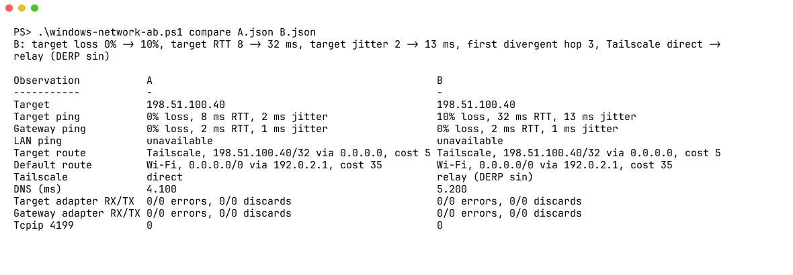

<div align="center">


# windows-network-ab

A PowerShell script that compares two Windows network captures and reports where the measurements changed.

[한국어](README.ko.md) · Windows PowerShell 5.1 · PowerShell 7

[](LICENSE)

[Install](#install) · [Quick start](#quick-start) · [Reference](#reference)

</div>

<p align="center">
  <picture>
    <source media="(prefers-color-scheme: dark)" srcset="https://raw.githubusercontent.com/elfenomenokim/windows-network-ab/main/docs/demo/compare-dark.png">
    
  </picture>
</p>

## Install

Download [windows-network-ab.ps1](windows-network-ab.ps1) into a local folder.
Run capture on Windows with NetTCPIP, NetAdapter and Event Log cmdlets available.
A standard Windows account can run the script. Install Tailscale only if you
want to record its peer path.

## Quick start

Set `$target` to the hostname or IPv4 address used by the remote screen client.
For a local smoke test, use `localhost`. Capture A in the first state, then
capture B after the path changes or while the drop is happening. Use the same
target for both.

```powershell
.\windows-network-ab.ps1 capture -Label A -Target $target
# Saved A.json
.\windows-network-ab.ps1 capture -Label B -Target $target
# Saved B.json
.\windows-network-ab.ps1 compare .\A.json .\B.json
```

The first line explains what changed. A comparison of the bundled
[synthetic fixtures](tests/fixtures) prints this verdict and a table.

```text
B: target loss 0% -> 10%, target RTT 8 -> 32 ms, target jitter 2 -> 13 ms, first divergent hop 3, Tailscale direct -> relay (DERP sin)
```

Run `.\windows-network-ab.ps1 compare .\A.json .\B.json -Json` to get the
verdict, changes, thresholds and both captures in one JSON object.

## Why

When a remote screen drops, compare a working capture with one from the
affected path. The gateway and optional LAN pings show whether the local
segment changed. The target ping, trace and peer status show changes toward
the remote machine.

[Test-NetConnection](https://learn.microsoft.com/powershell/module/nettcpip/test-netconnection)
tests TCP connectivity and explains Windows route selection.
[pathping](https://learn.microsoft.com/windows-server/administration/windows-commands/pathping)
measures loss at individual hops.
[Tailscale status](https://tailscale.com/docs/reference/connection-types)
shows the peer's current connection type.
`windows-network-ab` stores these kinds of observations together and compares
the two saved states.

## Reference

| Command or option | Effect |
|---|---|
| `capture -Label <label>` | Saves `<label>.json`. Use 1–64 ASCII letters, digits, underscores or hyphens, starting with a letter or digit. |
| `-Target <host>` | IPv4 address or ASCII hostname. Defaults to `8.8.8.8`. |
| `-LanHost <host>` | Adds a ping to this local IPv4 address or hostname. |
| `-Out <dir>` | Uses this directory for the capture. Defaults to the current directory. A matching file is overwritten. |
| `-ArpProbe` | Takes three read-only neighbor snapshots for the gateway after the pings. |
| `compare <a.json> <b.json>` | Prints a verdict and a table. Add `-Json` for machine output. |

The capture records the route Windows selects for the target and the default
IPv4 route with the lowest route metric plus interface metric. The gateway
ping uses the target route's next hop when available, or the default gateway
for an on-link route. The verdict reports increases in cumulative receive
and transmit errors and discards for matching adapters on the same PC.
The capture includes up to 20 Tcpip 4199 events from the previous 24 hours.
The verdict counts B's events that occurred after A started. Check `Errors`
for probes that could not complete.

Each ping uses ten probes. The comparison reports a difference of at least
10 percentage points in loss, 20 ms in average RTT, or 10 ms in jitter.
Jitter is the mean absolute difference between successive successful RTTs.
The loss threshold is one reply out of ten. The verdict reports a DNS
failure when the other capture resolved its hostname. It reports a DNS
timing change of at least 25 ms for the same hostname. The timing thresholds
are heuristics for this tool.

## Limits

- Use the same destination address to compare target ping and traceroute.
  A divergent hop requires a reply in both traces at the same hop number.
  A router can skip an ICMP reply while it still forwards traffic.
- Hostname timing includes the current Windows resolver cache. Capture uses
  the first IPv4 answer. A Tailscale peer path is a snapshot after the target
  probes. An idle peer may show `peer path unknown`.
- ICMP measurements show a network symptom. Measuring the remote screen
  application's TCP or UDP traffic requires an application-specific check.
- Windows PowerShell 5.1 captured a live peer on Windows 11. PowerShell 7
  was exercised on the same PC with a loopback target. The direct-to-DERP
  verdict uses synthetic fixtures.
- Capture files can include local addresses, peer endpoints and event details.
  Redact the file before sharing it.

[Contributing and tests](CONTRIBUTING.md)

[MIT license](LICENSE)

Tailscale and Windows are referenced for compatibility. This project is independent.
